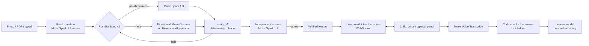

# Bar Model Tutor

**It doesn't solve your homework. It draws it with you.**

A child (P3–P6, Singapore) snaps a maths word problem. A teacher's voice and a live whiteboard build the
Singapore bar model with them, one step at a time, and stop to ask the child at every step. The child answers
by voice or by typing; code checks each answer against a verified bar model before the lesson moves on.

Meta Global AI Developer Hackathon, Indie track.

> **Not a chatbot, not a homework solver**
> - The child answers at every step; code checks each answer against a verified bar model.
> - The answer appears only after the child gets it or has used two hints. That rule is enforced in code.
> - Input is a photo and the child's voice; output is a drawn, narrated whiteboard. There is no chat window.
> - Every number is verified by code, and a second model must agree, before anything is drawn.

> **Who it's for, and safety**
> - This is a prototype. The account holder is a parent or guardian aged 18 or over, who signs in with Google,
>   agrees to the terms ([docs/terms.md](docs/terms.md)) and supervises their child's use.
> - The Meta Model API terms (section 10.1) require end users to be 18 or over. We built the consent step,
>   parent supervision, and the rule that no names, emails or progress reach a model with that in mind. We would
>   not offer this to children without Meta's written permission.
> - All evals use problems we wrote or collected and synthetic voices; no child's data was used to build or test it.

## What a lesson looks like

1. **Snap** a worksheet (camera, photo, PDF) or type the question. On a page with several questions the
   child taps which one.
2. **While the plan is made**, the teacher already reads the question aloud and highlights the numbers on the
   board, so there is no waiting screen.
3. **The board draws and stops.** "How many units is 1 unit worth?" The child taps the mic and answers. A clear
   number is judged about 0.6 s after they stop; anything else ends after 3 s of silence. Wrong → a hint →
   a second hint → the teacher shows it. The child can interrupt the teacher, ask "why?", or say "wait".
4. **Afterwards:** "Try one like this" (a twin problem with new numbers, also verified by code), method levels
   and badges, and the lesson saved to *My lessons* to replay.

Parents sign in with Google, agree to the terms, and add their children. Each child gets a hero name
(for example `Thor987`) and a password the parent can reset. Installs as a PWA on phones; four skins.

## How it works



- **BarSpec v2** (`docs/spec-v2.md`) describes the bars, stages (before/after), segments and the working as
  equations. `agent/verify_v2.py` solves the equations itself and rejects a plan whose numbers, bars or labels
  don't match the question. Nothing unverified reaches the child.
- **Two models must agree.** A different checkpoint (Muse Spark 1.2) answers the question on its own; a plan is
  shown only when the answers match.
- **The planner works in waves.** Spark drafts in parallel waves; a failed draft goes back with the checker's
  errors. We also fine-tuned Muse Glimmer to race Spark under the same gate. It was as accurate but made the median
  plan slower, so it is off in the live app (`PLANNER_MODEL=glimmer` turns it on).
- **The lesson is a WebSocket** (`app/lesson_ws.py`): board steps, teacher audio (Piper, offline TTS), the
  child's streamed voice, interrupts and checkpoints. `agent/lesson.py` builds the checkpoints from the
  verified spec, so the expected answers come from code, not from a model.
- **Personalisation:** `agent/learner.py` keeps an Elo-like rating per method (part–whole, before/after,
  constant difference…) and adapts pacing: challenge-first for strong methods, full walk-through for weak ones.

## Meta AI used

| Job | Model |
| --- | --- |
| Read photos and PDFs, plan the bar model, reply to the child's questions | `muse-spark-1.3` |
| Independent second answer (must agree) | `muse-spark-1.2` |
| Escalation on hard problems | `muse-wonder-1.0` |
| Plan racer, fine-tuned (LoRA) on maths word problems (an experiment, off in the live app) | Muse Glimmer, on Fireworks AI |
| The child's voice, streamed in real time | `muse-voice-transcribe-1.0` |

Standard tier only, never Contributor models. Names, emails and progress are never sent to a model.

## Results

| Eval | Result |
| --- | --- |
| Public word-problem set, all 107 | **107/107 correct, 0 wrong** |
| The first 100 of them again, with the fine-tuned Glimmer racing | 100/100 correct, 0 wrong; Glimmer's plan won 42 |
| School-style held-out set, 180 problems | 162 correct, the rest declined; 2 scored wrong: an answer-key error, and an answer given in cm where the key used m |
| 150 fresh school questions never seen before (P4–P6, mostly 3+ marks) | 141 right after checking the answer keys (4 keys were wrong), 1 wrong (now declined), 8 declined |
| A hand-picked 300 (complex before–after, transfer, ratio change, hard wording): 200 practice | 196/200 correct, 1 unit mix-up (270¢ vs $2.70), 3 declined |
| The same 300: 100 held back and run once, after the fixes | **99/100 correct, 0 wrong**, 1 declined |
| Photos of real scanned pages | 75/80 questions read exactly |
| Spoken answers (TTS → real-time ASR) | 20/20 numbers understood |
| Adversarial child questions to the tutor | 0 unsafe replies shown out of 124 |
| Voice-turn rules (who talks when: a clear number ends the turn, silence, tap to stop) | covered by unit tests in `tests/test_lesson_ws.py` |
| Unit and integration tests | 755 passing (`pytest -q`) |

The tutor declines a problem rather than show an answer it couldn't verify.

## Run it

```bash
python3 -m venv .venv && source .venv/bin/activate
pip install -r requirements.txt
cp .env.example .env   # add META_API_KEY
uvicorn app.main:app --reload
```

Open http://127.0.0.1:8000. Without a key, the built-in example lessons still work. Optional settings:

| Variable | What it does |
| --- | --- |
| `GOOGLE_CLIENT_ID` | Google sign-in for parents (otherwise `ALLOW_DEV_LOGIN=1` for local testing) |
| `SESSION_SECRET` | Signs session cookies |
| `PUBLIC_DEPLOY=1` | Public mode: the AI needs a signed-in family; `/admin` only for `ADMIN_EMAILS` |
| `ADMIN_EMAILS` | The Google accounts that open the admin dashboard (`/admin`) when they sign in. There is no admin password. |
| `SHOWCASE_DIR` | Videos, slide images and `manifest.json` for the Showcase screen (`/showcase`) |
| `PLANNER_MODEL=glimmer`, `FIREWORKS_API_KEY`, `GLIMMER_MODEL_PATH` | Race the fine-tuned Glimmer |
| `PLANS_PER_FAMILY_DAY`, `PLANS_PER_DAY` | Daily limits on new problems |

Teacher voice: download a Piper voice to `renderer/voice.onnx`
(`python3 -m piper.download_voices en_US-lessac-medium --download-dir renderer`); `ffmpeg` on PATH for MP3.

```bash
pytest -q                                  # tests
python evals/run_evals.py --suite all      # evals (needs META_API_KEY)
python evals/e2e_browser.py                # headless browser lesson
```

## Privacy

Photos, audio and transcripts are processed in memory and never stored. We keep the parent's display name,
each child's nickname, level, hero name, a hashed password, lesson progress and saved lessons (as specs, not
video). Parents can delete a child or the whole account. See [docs/privacy.md](docs/privacy.md) and
[docs/terms.md](docs/terms.md).

## Docs

- [BarSpec v2](docs/spec-v2.md) · [Board templates](docs/board-templates.md) · [Testing](docs/testing.md) · [Evals](docs/evals.md)

## License

Copyright (c) 2026 Palaniappan, Jinboost.com. All rights reserved. The code is published for viewing and for the
hackathon's judging; see [LICENSE](LICENSE).
